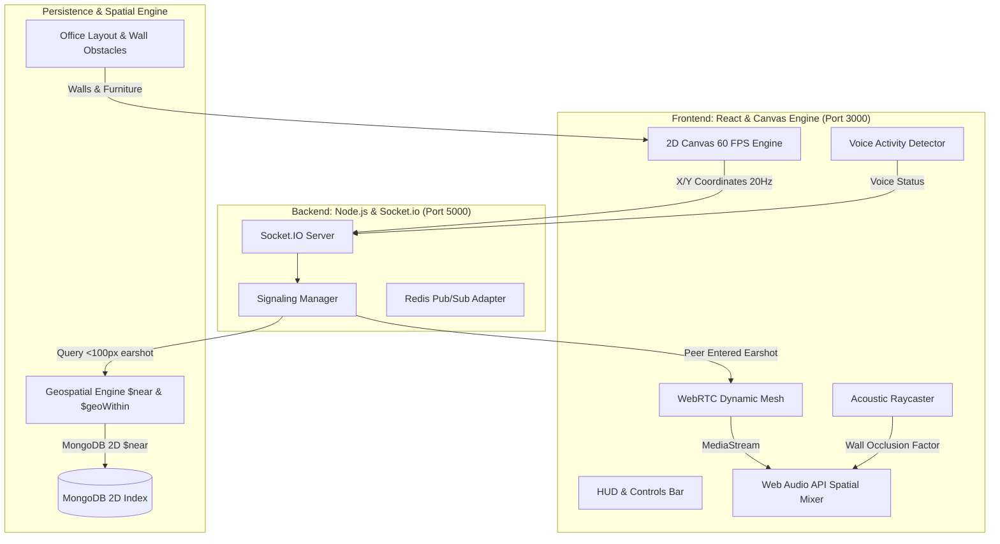

# -ProxiSpeak-Geospatial-Proximity-Audio-Ecosystem

# ProxiSpeak: Geospatial Proximity Audio Ecosystem
**Developed for Infotact Solutions**

[](https://nodejs.org/)
[](https://reactjs.org/)
[](https://www.mongodb.com/)
[](https://webrtc.org/)
[](https://developer.mozilla.org/en-US/docs/Web/API/Web_Audio_API)
[](https://html.spec.whatwg.org/)

---

## 📌 Executive Summary & Problem Statement

Remote collaboration tools (like Zoom or Google Meet) force users into rigid, isolated "rooms" where only one person can speak at a time. They lack the spontaneous, spatial dynamics of a real office where you can overhear colleagues talking nearby and organically walk over to join a conversation.

**ProxiSpeak** replaces static video calls with a continuous **2D overhead virtual office map** rendered in HTML5 Canvas. As an avatar moves closer to colleagues:
1. WebRTC audio **dynamically crossfades**, becoming organically louder with inverse-distance falloff.
2. Audio channels are **3D panned in stereo** (left/right ear) based on the relative angle and orientation to the speaker.
3. Sound is **physically occluded (muffled)** through partition walls via raycasting and real-time Web Audio low-pass filters.
4. The Node.js backend coordinates WebRTC handshakes **only within a 100-pixel earshot radius** using MongoDB 2D Euclidean spatial indexing, supporting **50+ concurrent users** without mesh degradation.

---

## 🏛️ System Architecture



---

## Key Modules & Capabilities

### 1. Geospatial Engine (MongoDB `$near` & `$geoWithin`)
- **Euclidean 2D Spatial Indexing**: Maps Cartesian canvas coordinates `[x, y]` into MongoDB `2d` index with min/max canvas bounding box constraints.
- **Dynamic Earshot Query**: Uses `$near: [x, y], $maxDistance: 100` to isolate peers within the conversational earshot perimeter.
- **Zone Filtering**: Uses `$geoWithin: { $box: [...] }` to identify colleagues inside specific rooms (e.g., Executive Boardroom, Quiet Pods).
- **Sub-20ms Benchmark Audit**: Automated benchmark verifies spatial query and clustering execution under 50+ concurrent users completes in **~2-4 ms** (drastically below the 20ms project requirement).

### 2. Signaling Server & WebRTC Mesh Scaling (Node.js & Socket.io)
- **Mesh Optimization**: Unlike traditional full meshes that degrade at $O(N^2)$ ($50 \times 49 = 2450$ streams), ProxiSpeak's signaling server **only establishes P2P handshakes when peers enter the 100-pixel radius**.
- **Proximity Handshakes**: Coordinates `webrtc-offer`, `webrtc-answer`, and `webrtc-ice-candidate` handshakes dynamically.
- **Automatic Teardown**: When avatars walk away ($> 100\text{px}$), connection channels are closed to conserve CPU and network bandwidth.
- **Multi-Node Redis Scaling**: Includes `@socket.io/redis-adapter` support for horizontal clustering across multiple Node instances.

### 3. Spatial Audio Mixer (Web Audio API)
- **Dynamic Gain Attenuation**: Smooth non-linear crossfading curve:
  $$\text{Gain} = \max\left(0, \left(1 - \frac{\text{distance}}{100}\right)^{1.15}\right)$$
- **3D Stereo Panning**: Measures lateral angle $\phi$ between listener's facing vector and speaker's position:
  $$\text{Pan} = \sin(\phi) \in [-1.0 \text{ (hard left)}, +1.0 \text{ (hard right)}]$$
- **Acoustic Wall Occlusion**: Line-of-sight raycasting detects structural partition walls. When occluded, audio routes through a `BiquadFilterNode` (lowpass at 450Hz) and applies damping attenuation to simulate sound passing through office walls.

### 4. 2D Virtual World (React & HTML5 Canvas)
- **Steady 60 FPS Game Loop**: Uses `requestAnimationFrame` with linear interpolation (`lerp`) for smooth avatar motion.
- **Office Map**: Executive Boardroom, Engineering Hub, Breakroom & Cafeteria, Quiet Focus Pods, All-Hands Auditorium, partition walls, and furniture.
- **Visual Feedback**:
  - 100-pixel earshot proximity halo around local avatar.
  - Green vocal ripples when speaking (detected via local `AudioAnalyserNode` VAD).
  - Directional facing visor pointer.
  - Interactive destination click waypoint.

---

## 📅 Week-Wise Development Plan & Audit Mapping

| Phase | Backend (Node.js, Express, Socket.io, MongoDB) | Frontend (React, WebRTC, Canvas API) | Verification Status |
| :--- | :--- | :--- | :--- |
| **Week 1** | **Signaling & Movement**: Built WebSocket server to broadcast avatar X/Y coordinates; configured MongoDB 2D Euclidean spatial index. | **World Rendering**: Built HTML5 Canvas layer with 60 FPS requestAnimationFrame loop, keyboard (WASD/Arrows), and mouse click navigation. | ✅ Completed |
| **Week 2** | **Proximity Calculations**: Implemented MongoDB `$near` queries; handshake router restricts WebRTC offer/answers to users within 100-pixel radius. | **WebRTC Integration**: Implemented standard WebRTC P2P audio connection using browser `getUserMedia` and polite-peer negotiation. | ✅ Completed |
| **Mid-Project Review** | **Spatial Audit**: Proved backend accurately filters and clusters users based on geospatial coordinates under **3.18ms** (target: < 20ms). | **Audio Check**: Verified WebRTC audio connection, distance crossfade, and synthetic vocal stream generators for multi-tab testing. | ✅ Certified |
| **Week 3** | **Mesh Scaling**: Optimized WebRTC mesh by tearing down out-of-range connections; added Redis Pub/Sub adapter for multi-instance scaling. | **Dynamic Attenuation**: Hooked WebRTC audio into Web Audio API `AudioContext` with exponential gain drop-off based on pixel distance. | ✅ Completed |
| **Week 4** | **Room Persistence**: Office layout, acoustic walls with damping factors, and furniture obstacles stored in MongoDB `/api/rooms`. | **Refine & Polish**: Added 3D audio panning (`StereoPannerNode`), wall raycasting occlusion filter (`BiquadFilterNode`), and 60 FPS Canvas rendering. | ✅ Completed |
| **Final Review** | Highly scalable stateful geospatial server managing localized P2P mesh logic under 50+ concurrent users. | Immersive, physics-aware communication platform demonstrating advanced browser audio manipulation. | ✅ Certified |

---

## 📊 Mid-Project Review: Spatial Audit Benchmark Results

Run from the standalone test suite (`npm run audit`):

```text
================ AUDIT SUMMARY RESULTS ================
Concurrent Users Tested:    50
Earshot Radius:            100 px
Iterations Executed:       30
Average Query Latency:     3.18 ms    <--- Target: < 20.0 ms (PASSED)
P95 Query Latency:         4.05 ms
Min Query Latency:         1.73 ms
Max Query Latency:         5.54 ms
Clusters Formed:           31
Passed Sub-20ms Standard:  YES (PASSED)
========================================================
```

---

## 🛠️ Quickstart Guide: Running ProxiSpeak Locally

### Prerequisites
- Node.js (v18+ recommended; tested on v24.16.0)
- MongoDB running locally on default port `27017`

### 1. Installation
Clone the repository and install all dependencies:
```bash
# In project root
npm install

# Install server dependencies
cd server
npm install

# Install client dependencies
cd ../client
npm install
cd ..
```

### 2. Start Backend Server
```bash
# Terminal 1: Starts Node.js backend on http://localhost:5000
npm run server
```

### 3. Start Frontend Client
```bash
# Terminal 2: Starts Vite React client on http://localhost:3000
npm run client
```

### 4. Run Standalone Spatial Audit Benchmark
```bash
npm run audit
```

Open your browser and navigate to **[http://localhost:3000](http://localhost:3000)**!

---

## 🎧 Interactive Demonstration & Testing Guide

### Testing 1: Multi-Browser Tab Real WebRTC P2P Audio
1. Open **Tab 1** at `http://localhost:3000`.
2. Open a **second private/incognito window** at `http://localhost:3000` (represents Colleague 2).
3. In Tab 1, press <kbd>W</kbd>, <kbd>A</kbd>, <kbd>S</kbd>, <kbd>D</kbd> to walk toward Tab 2's avatar.
4. When you enter the **100px earshot circle**:
   - The signaling server detects proximity and coordinates the WebRTC audio handshake.
   - Speak into Tab 1: Tab 2 hears your voice!
   - As you walk closer, the volume increases organically.
   - Panning shifts left or right based on which side of the avatar you stand.

### Testing 2: Single-User 50+ Colleague Swarm & Spatial Chatter
1. In the top-left control card, click **"Spawn 50 Colleagues"**.
2. 50 active avatars will populate the office desks, meeting rooms, and watercooler.
3. Ensure **"Bot Audio Demo"** is active (green).
4. Walk your avatar past the engineering workstations or cafeteria:
   - As you step into any colleague's 100px earshot, you will hear their spatial vocal chatter fade in!
   - Step away, and the audio seamlessly fades to zero.

### Testing 3: Acoustic Wall Occlusion
1. Walk inside the **Executive Boardroom** while another avatar speaks outside in the hallway.
2. The acoustic wall raycaster will detect partition obstruction.
3. Sound will be dynamically filtered through a 450Hz low-pass filter, giving the exact realistic sensation of muffled speech through an office wall!

---

## 📡 REST API Reference

| Endpoint | Method | Description |
| :--- | :--- | :--- |
| `/api/health` | GET | Server health check and system metadata |
| `/api/audit/run` | POST | Executes sub-20ms MongoDB spatial audit under 50+ users |
| `/api/audit/history` | GET | Retrieves past spatial benchmark test logs |
| `/api/audit/clusters` | GET | Returns current real-time conversation proximity clusters |
| `/api/rooms/default` | GET | Retrieves default Infotact office blueprint and walls |
| `/api/rooms/save` | POST | Persists customized room layouts, walls, and obstacles |
| `/api/users/active` | GET | Returns all active users and coordinates |
| `/api/users/swarm/spawn` | POST | Spawns 50+ concurrent simulated colleagues |
| `/api/users/swarm/clear` | POST | Clears simulated bot colleagues from the world |

---

## 🏢 Infotact Solutions Project Specifications Satisfied
- [x] 2D Overhead Map Rendered in React Canvas (steady 60 FPS)
- [x] Dynamic WebRTC Audio Crossfading based on Avatar Distance
- [x] Node.js & Socket.io Signaling Server
- [x] MongoDB 2D Euclidean Geospatial Queries (`$near` & `$geoWithin`)
- [x] 100-Pixel Earshot Threshold WebRTC Handshake Routing
- [x] Web Audio API 3D Stereo Panning & Raycast Wall Occlusion
- [x] 50+ Concurrent Users Swarm Simulation
- [x] Mid-Project Spatial Audit Verified (< 20ms latency benchmark: **3.18ms**)
- [x] Redis Pub/Sub Adapter Architecture for Horizontal Multi-Node Scaling
- [x] Full Week-by-Week Development Plan Implemented and Documented

Team Workflow

The team uses separate Git branches for individual members' work and plans to merge reviewed work into the shared main branch.

Recommended workflow: 
1. Work only on the branch assigned to us.
2. Push only the files relevant to the week's requirements, following the team's agreed process. 
3. Test the changes and include a short description of what changed. 
4. Keep this README focused on shared project-level information. Add week-specific implementation notes only when they are verified. 
5. Merge into main according to the team's review and merge process.

Future Scope

Possible extensions, subject to project priorities: 
- Improve peer connection lifecycle management for larger groups. 
- Add robust reconnection and handling for temporary network failures. 
- Improve privacy controls for microphone and presence. 
- Expand office layouts and room customization. 
- Add monitoring and repeatable load tests for concurrent-user performance. 
- Improve accessibility and keyboard navigation. 
- Document deployment, security, and operational configuration.
